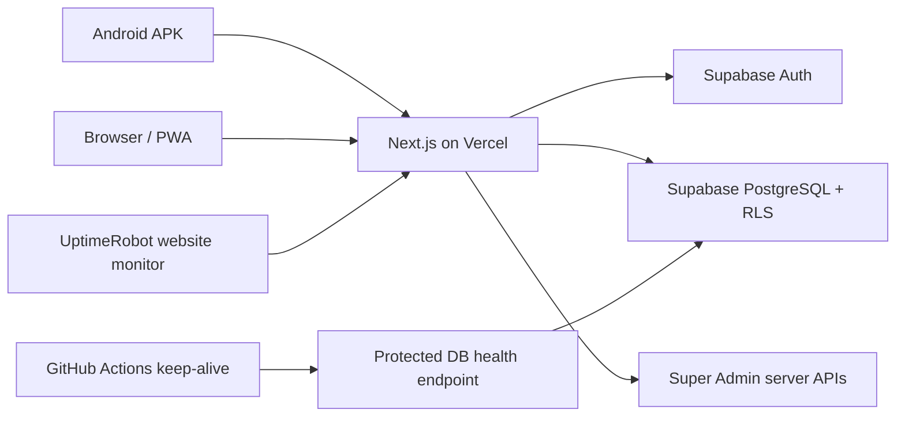

# Maya Steel Works Management System


[](https://github.com/lumuxav/maya-steel-works/actions/workflows/maya-prelaunch-validation.yml)
[](https://github.com/lumuxav/maya-steel-works/actions/workflows/build-android-apk.yml)
[](https://github.com/lumuxav/maya-steel-works/actions/workflows/keep-supabase-active.yml)

A private, role-aware business management system built **exclusively for Maya Steel Works — Maya Branch**. It tracks inventory, deliveries, production, sales, customer-supplied material processing, debts, cash/expenses/banking, stocktakes, discrepancies, reports and accounts.

> **Production web app:** https://maya-steel-works-mgt.vercel.app  
> **Business start date:** Monday, **12 October 2026** (`Africa/Kampala`)  
> **Source of truth:** `main` in **`lumuxav/maya-steel-works`**  
> **Strict project isolation:** This is **NOT Universal MGT**. Never join their codebases, databases, environments, deployment projects or business records.

## Download / install

| Platform | Status and access |
| --- | --- |
| Android | **[Latest GitHub release](https://github.com/lumuxav/maya-steel-works/releases/latest)** → open **Assets** → `Maya-Steel-Works.apk` |
| Web / Windows / macOS | **[Open Maya Steel Works](https://maya-steel-works-mgt.vercel.app)** |
| PWA | Install the same website using browser Add to Home Screen / Install when supported |
| iPhone / iPad | Use the web app. Native iOS simulator validation exists, but **no signed IPA has been published** |

See [DOWNLOADS.md](DOWNLOADS.md) for installation and updating guidance. Because the repository is **private**, GitHub release downloads require an authorized GitHub login.

**Android:** Capacitor 8 shell (`com.mayasteelworks.management`), native Back navigation with a previous-page action and double-Back-to-exit on Home. Native changes require a **new APK**; website changes normally load from Vercel. Current APK builds are **debug-signed** and might require uninstall/reinstall if signing keys differ. Plan stable release signing before extensive distribution.

GitHub releases use **versioned tags** such as `maya-android-build-17`; the `releases/latest` link points to the newest. The previous fixed `maya-latest` tag is **legacy** and must not be used as the default download destination.

## Documentation — start here

| Document | Purpose |
| --- | --- |
| **[Architecture & Data Model](docs/ARCHITECTURE_AND_DATA_MODEL.md)** | Technology, pages, data tables, relationships and 12 accounting invariants |
| **[Daily Operations Manual](docs/DAILY_OPERATIONS_MANUAL.md)** | Step-by-step Employee, Business Admin and Super Admin business workflows |
| **[Security, Deployment & Monitoring](docs/SECURITY_DEPLOYMENT_MONITORING.md)** | Protected Supabase health checks, GitHub schedule, UptimeRobot, access, secrets, backups and deployment |
| **[Testing, Release & Recovery](docs/TESTING_RELEASE_AND_RECOVERY.md)** | Free test pipeline, acceptance checklist, rollback, recovery and open operational requirements |
| **[Downloads](DOWNLOADS.md)** | Latest Android APK, desktop web, PWA and iOS availability |

### Historical handover / audit records

- [Original System Handover](docs/MAYA_SYSTEM_HANDOVER.md)
- [Earlier Production Status Addendum](docs/LATEST_PRODUCTION_STATUS.md)
- [Production Cutover Notes](docs/PRODUCTION_CUTOVER.md)
- [October Pre-launch Audit](docs/MAYA_PRELAUNCH_AUDIT_OCT12.md)
- [Handover PDF (historical snapshot)](docs/Maya-Steel-Works-System-Handover.pdf)

Some older handover pages refer to `maya-latest`, the previous launch date or features before subsequent security migrations. **The current code and the four updated manuals above take precedence.** Do not mistake historical documents for live state.

## Main business areas

- **Stock:** raw material, finished products, movement history, physical stocktake.
- **Receiving:** supplier deliveries, specs/units, transport and cost visibility appropriate to role.
- **Production:** standards, raw consumption, finished output, expected/actual yield, scrap, Make & Sell.
- **Sales & credit:** cash/partial/credit, automated stock deduction, outstanding balances, later payments, returns and compensation.
- **Customer-owned material:** ribbing/forming, strips, louvers, services charged per plate/piece. **Do not deduct Maya-owned stock** for customer-supplied material.
- **Cash Book:** actual sales/service cash + debt repayment cash − expenses − **confirmed** banking, day-by-day archive beginning 12 October 2026.
- **Management:** activity alerts, discrepancies, profit/production reports, audited financial corrections.
- **System:** active users, Employee/Admin/Super Admin roles, password resets and archived-account restoration.
- **Experience:** responsive mobile header with Back arrow, Android double-Back exit, desktop scrollable sidebar, Light/Dark/Navy themes and installable PWA.

## Roles

| Role | Primary authority |
| --- | --- |
| Employee | Day-to-day permitted operational activity |
| Admin | Business owner/manager; financial, stock and operational oversight and approved corrections |
| Super Admin | Technical system administration; accounts/roles, password and service troubleshooting |

Every transaction and privileged operation must be checked at the database/API layer; hiding a UI button is not sufficient. Archived account identities are retained for audit continuity, and only the **same returning employee** may be restored using the existing identity.

## Technology and deployment



- **Framework:** Next.js 16 / React 19.
- **Backend:** Supabase Auth, PostgreSQL RLS and atomic `maya_ledger` / `maya_correct_record` RPCs.
- **Web hosting:** Vercel project `maya-steel-works-eboa`.
- **Mobile:** Capacitor 8 / Gradle builds and GitHub APK releases.
- **CI:** free GitHub Actions tests and isolated runner-local PostgreSQL 16 integration environment; no production test writes.

## Encrypted backup and recovery (opt-in)

The **System Super Admin** can open **System Control → Backup & Recovery** at `/backups`. The [Maya encrypted database backup workflow](.github/workflows/maya-encrypted-backup.yml) uses PostgreSQL 17 and age public-key encryption and supports on-demand export or an opt-in daily schedule at **01:53 Uganda**.

**Security first:** live backups do **not** run until you configure the Maya-only database URL secret, the age **public** recipient variable and enable the schedule after successfully verifying a manual export. Your age **private** decryption key stays offline—never in GitHub/Vercel. GitHub holds only encrypted `.age` artifacts for **3 days**, so permanently retained backups **must be downloaded elsewhere**. Supabase Storage file binaries require separate exports. The workflow has a 60 MiB size guard to limit free artifact storage consumption; GitHub Actions usage quotas still apply.

**[Full setup, verification, restore and zero-cost guide](docs/BACKUP_AND_RECOVERY.md)**

## Supabase keep-alive & website monitoring

The Maya repository already contains two independent checks:

1. **Database-backed keep-alive:** [`keep-supabase-active.yml`](.github/workflows/keep-supabase-active.yml) is **scheduled** at minute 17 every six hours (UTC). It calls the protected `/api/health/supabase` endpoint, which executes a small **real** Supabase `users` query. Secrets: `MAYA_HEALTHCHECK_SECRET` in GitHub Actions must match `HEALTHCHECK_SECRET` in Vercel Production; Supabase service role stays server-side.
2. **Website uptime monitor:** UptimeRobot was previously configured outside this repo for approximately five-minute website checks. Verify its actual enabled state/history/alerts in the UptimeRobot dashboard; the monitor is **not** proof of Supabase database health.

**Verification status (9 Oct 2026):** GitHub workflow/endpoint code inspected and Maya Supabase answered a live read-only query. Recent keep-alive scheduled-run success, GitHub secret presence, Vercel secret equality and UptimeRobot's current dashboard could **not** be independently verified with available connector access. The GitHub workflow is *configured*, but its live schedule should be confirmed in the Actions interface using **Run workflow** and recent run history.

Supabase Free projects may pause after a week of inadequate database activity **even with occasional requests**; GitHub schedules can be delayed or disabled. Do not claim guaranteed uptime. [Full guide and verification steps](docs/SECURITY_DEPLOYMENT_MONITORING.md).

## Installation and development

Requires modern Node.js (CI uses **Node 22**), npm, a separately owned Maya Supabase project and authorized environment configuration.

```bash
git clone https://github.com/lumuxav/maya-steel-works.git
cd maya-steel-works
npm ci
npm run dev
```

Create a local `.env.local` (never commit its values):

```env
NEXT_PUBLIC_SUPABASE_URL=YOUR_MAYA_SUPABASE_URL
NEXT_PUBLIC_SUPABASE_ANON_KEY=YOUR_MAYA_SUPABASE_ANON_KEY
SUPABASE_SERVICE_ROLE_KEY=SERVER_ONLY_SUPABASE_KEY
HEALTHCHECK_SECRET=LONG_RANDOM_SERVER_SECRET
```

GitHub Actions stores the **same health secret** under `MAYA_HEALTHCHECK_SECRET`. `SUPABASE_SERVICE_ROLE_KEY` and `HEALTHCHECK_SECRET` must **never** receive a `NEXT_PUBLIC_` prefix.

```bash
npm run test:logic
npm run build
npm start
```

CI: [Maya prelaunch tests](.github/workflows/maya-prelaunch-validation.yml) · [APK builder](.github/workflows/build-android-apk.yml) · [iOS validation](.github/workflows/validate-ios.yml). Android native builds require a compatible Java/Android SDK toolchain; CI handles this automatically.

### Development safety rules

- Never run `scripts/reset-test-business-data.sql` after Maya begins live trading.
- Keep client/service secrets and real business data out of Git history, artifacts and test fixtures.
- Use PR checks and synthetic PostgreSQL fixtures; do not create destructive test transactions in live Supabase.
- Preserve authorization policies, idempotent transaction semantics and accounting audit history.
- Take a recoverable offsite database backup before important migrations and regularly thereafter.
- Do not connect, edit, migrate or deploy anything from Universal MGT into this project.

## Operational readiness and limitations

- **Confirmed:** code-level keep-alive, an accessible Maya database on 9 Oct 2026, versioned GitHub Android releases, past CI successes.
- **Needs owner verification:** recent scheduled keep-alive successes, current UptimeRobot monitor/alert status, correct Vercel/GitHub secret pairing, ongoing offsite backups and provider plan suitability for commercial use.
- **Distribution:** Android is debug-signed; iOS not yet distributed as signed IPA; desktop is web-only.
- **Accounting:** reports using limited-row UI queries must be reconciled against full ledgers as transaction volume grows.
- **Hosting:** the `vercel.app` domain may be retained when a custom domain is purchased, with data remaining in the same Supabase project. Confirm hosting terms/plan for real commercial use.

## Licence and privacy

Private proprietary business source for Maya Steel Works. No open-source licence is currently granted. Staff credentials, database tokens, business records and backups must not be committed or redistributed.

---

**Maya Steel Works — Inventory · Production · Services · Sales · Debt · Cash · Reporting · Administration**
