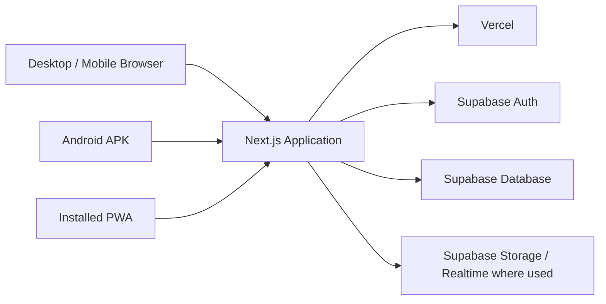

# Maya Steel Works Management System


[](https://github.com/lumuxav/maya-steel-works/actions/workflows/build-android-apk.yml)

A full business-management platform built specifically for **Maya Steel Works**.

The system brings inventory, deliveries, production, sales, credit/debt tracking, customer-owned material jobs, expenses, banking, cash control, management reporting, alerts and system administration into one responsive application.

It runs as a web application, can be installed as a PWA, and can also be packaged as a directly installable Android APK.

> **Production:** https://maya-steel-works-mgt.vercel.app

---

## Complete project handover documentation

For full context on the system, business rules, architecture, solved issues, deployment history, Android/iOS work and the decisions made during development, use the project handover:

- **[Download / open the complete Maya Steel Works System Handover PDF](docs/Maya-Steel-Works-System-Handover.pdf)**
- **[Read the editable handover source](docs/MAYA_SYSTEM_HANDOVER.md)**

The PDF is generated from the Markdown source by `.github/workflows/generate-handover-pdf.yml`, so future project-context updates should be made in `docs/MAYA_SYSTEM_HANDOVER.md` and the PDF will be regenerated automatically.

A future developer or ChatGPT session should read the handover before making significant changes, then inspect the current `main` branch because the code may have advanced since the handover was last updated.

---

## What the system manages

Maya Steel Works is designed around the actual day-to-day movement of stock, work and money inside the business.

### Inventory

- Raw-material stock management
- Finished-goods stock management
- Delivery receiving
- Quantity tracking
- Physical stocktake support
- Stock corrections and audit history
- Item lifecycle reports showing how stock was received, produced, used or sold
- Maya Branch-only operating scope

### Production

- Convert raw materials into finished goods
- Record raw-material usage
- Record expected and actual production output
- Track scrap/waste where applicable
- Maintain production history
- Surface production differences to management

### Sales

- Sell finished goods
- Sell raw materials
- Record paid, partial and credit sales
- Automatically deduct stock where appropriate
- Track customer balances
- Record later debt repayments
- Keep sales and debt history linked to the responsible staff member

### Customer-owned material work

Customers can bring their own metal/material for Maya Steel Works to process.

The system can record services such as:

- Ribbing/forming
- Cutting kibaati/plain strips
- Louver-related work
- Plate/piece-based service work

For these jobs, Maya inventory is **not deducted** because the material belongs to the customer. The system records the number of plates/pieces worked on, the charge per piece and the resulting service revenue.

### Cash Book & Banking

- Daily cash received
- Daily expenses
- Cash still on hand
- Banking records
- Pending and confirmed banking
- Opening cash carried forward from previous days
- Continuous day-by-day cash archive
- Cash-source breakdown showing where today's money came from
- Debt repayments reflected in the day's cash position
- Customer-material/service revenue reflected separately

The cashbook is designed to preserve the story of each business day rather than only showing a current balance.

### Alerts & Management Activity

Management can see important operational events including:

- Credit sales
- Debt repayments
- Banking awaiting confirmation
- Flagged banking differences
- Production variances
- Stocktake differences
- Expenses
- Other business exceptions requiring attention

### Reports

The system includes operational and management reporting for areas such as:

- Sales and credit
- Inventory
- Production
- Cash and banking
- Customer debt/payment history
- Stock lifecycle/history
- Corrections and exceptions

---

## User roles

Maya Steel Works uses role-based access so each user sees the parts of the system appropriate to their responsibilities.

### Employee

Employees handle normal operational work such as stock activity, sales, customer-material jobs and other permitted day-to-day tasks.

Employees do not receive owner-level financial oversight or system-administration powers.

### Admin

The **Admin is the business owner/manager**.

The Admin is responsible for business oversight and can access management information such as:

- Daily business activity
- Sales and credit information
- Cash and banking
- Business reports
- Alerts and exceptions
- Operational performance
- Profit/business information where implemented

The Admin represents ownership/management of the business, not technical administration of the software.

### Super Admin

The **Super Admin manages the system itself**.

Super Admin capabilities include:

- System monitoring
- User-account management
- Role management
- Password resets
- Account activation/deactivation
- Permanent account removal/archiving
- System alerts and integrity monitoring
- Troubleshooting operational issues

A Super Admin is intentionally separated from the business-owner Admin role.

---

## Account security

The application uses **Supabase Auth** for authentication and a Maya user profile/role layer for authorization.

Important account protections include:

- Inactive users are blocked from signing in
- Disabling an account revokes access instead of waiting for the user to manually log out
- Active sessions regularly re-check account access
- Super Admin actions are verified server-side
- A Super Admin cannot accidentally remove their own system access through the normal user controls
- Deleted users can be hidden/revoked while historical IDs are preserved where necessary for audit integrity
- Sensitive administration uses a server-only Supabase secret/service key

> Never expose `SUPABASE_SERVICE_ROLE_KEY` in browser code, commit it to GitHub, or prefix it with `NEXT_PUBLIC_`.

---

## Appearance & mobile UX

The interface is responsive and designed for both desktop and phone use.

Users can choose between:

- Light theme
- Dark theme
- Navy theme

Settings also include display preferences, reduced motion, compact layout options, notification controls and built-in help.

---

## Architecture



The Android application is a Capacitor shell connected to the live production system, so most business-logic and UI updates can be deployed through the web application without rebuilding the APK.

---

## Technology stack

| Layer | Technology |
| --- | --- |
| Frontend | Next.js 16, React 19 |
| Styling | Tailwind CSS 4 + application CSS |
| Backend/Data | Supabase |
| Authentication | Supabase Auth |
| Hosting | Vercel |
| PWA | Web App Manifest + Service Worker |
| Android packaging | Capacitor |
| Android builds | GitHub Actions |

---

## Environment variables

Create a `.env.local` file in the project root for local development:

```env
NEXT_PUBLIC_SUPABASE_URL=your_supabase_project_url
NEXT_PUBLIC_SUPABASE_ANON_KEY=your_supabase_anon_or_publishable_key
SUPABASE_SERVICE_ROLE_KEY=your_server_side_supabase_secret_key
```

### Key rules

`NEXT_PUBLIC_SUPABASE_URL` and `NEXT_PUBLIC_SUPABASE_ANON_KEY` are used by the browser-side Supabase client.

`SUPABASE_SERVICE_ROLE_KEY` is used only by protected server-side administration endpoints and must remain secret.

All three values must belong to the **same Supabase project**.

For Vercel, configure the same variables under the project's **Environment Variables** settings for the environments you intend to use.

---

## Local development

### Requirements

- Node.js 22 or compatible version
- npm
- Access to the Maya Steel Works Supabase project or a compatible development database

### Install

```bash
git clone https://github.com/lumuxav/maya-steel-works.git
cd maya-steel-works
npm install
```

Create `.env.local`, then start the development server:

```bash
npm run dev
```

Open:

```text
http://localhost:3000
```

### Production build

```bash
npm run build
npm start
```

### Lint

```bash
npm run lint
```

---

## Deployment

The production application is deployed through **Vercel**.

### Branch workflow

- `main` — production source of truth
- `chatgpt-refinement` — preview/testing branch when needed

Production deployments should be based on `main`.

Current production URL:

```text
https://maya-steel-works-mgt.vercel.app
```

Before merging major changes into `main`, test the affected workflows using the preview deployment where possible.

---

## Android APK

The repository contains a Capacitor configuration for an Android wrapper of the production application.

Android package ID:

```text
com.mayasteelworks.management
```

The app connects to:

```text
https://maya-steel-works-mgt.vercel.app
```

### Build automatically with GitHub Actions

The workflow is located at:

```text
.github/workflows/build-android-apk.yml
```

When the Android packaging files or workflow are updated on `main`, GitHub Actions builds an installable APK.

To download a successful build:

1. Open the repository on GitHub.
2. Select **Actions**.
3. Open **Build Android APK**.
4. Open the latest successful run.
5. Under **Artifacts**, download **Maya-Steel-Works-APK**.
6. Extract the downloaded ZIP.
7. Install `Maya-Steel-Works.apk` on the Android device.

The current workflow produces a **debug-signed APK intended for direct testing/internal installation**. A production release intended for wider distribution should use a securely stored release keystore and a release-signed APK/AAB.

---

## PWA installation

The web application also includes PWA support.

On supported Android browsers, users can install Maya Steel Works from the browser's **Install app** / **Add to Home screen** option.

The PWA is configured to avoid intentionally caching private business data for offline use. Offline support is limited to a safe application shell/fallback rather than offline transaction processing.

---

## Main project structure

```text
maya-steel-works/
├── app/
│   ├── api/                 # Protected server/API routes
│   ├── alerts/              # Management activity & alerts
│   ├── cashbook/            # Cash, expenses and banking
│   ├── corrections/         # Controlled corrections/audit workflows
│   ├── customer-work/       # Customer-owned material jobs
│   ├── deliveries/          # Receiving stock deliveries
│   ├── inventory/           # Stock and lifecycle history
│   ├── login/               # Authentication
│   ├── production/          # Production workflows
│   ├── reports/             # Management reporting
│   ├── sales/               # Sales workflows
│   ├── settings/            # Profile, appearance and preferences
│   ├── system/              # Super Admin system control
│   ├── users/               # Super Admin user management
│   ├── manifest.js          # PWA manifest
│   ├── layout.js            # Global application shell
│   └── page.js              # Main dashboard
├── assets/                  # Branding/mobile assets
├── lib/                     # Shared Supabase and branch helpers
├── mobile-shell/            # Capacitor web shell
├── public/                  # Public/static assets and service worker
├── .github/workflows/       # CI / Android APK workflow
├── capacitor.config.json    # Android/Capacitor configuration
├── next.config.mjs          # Next.js configuration
├── package.json
└── README.md
```

---

## Business scope

This installation is intentionally scoped to **Maya Branch**.

The system should not combine or imply knowledge of stock, sales, banking, production or cash activity from other branches unless explicit multi-branch functionality is introduced in the future.

This design keeps the figures shown to staff and management aligned with the operations actually being recorded in this installation.

---

## Data integrity principles

Changes to the system should preserve the following rules:

1. Stock must only change through valid stock/production/sales workflows.
2. Customer-owned material jobs must not reduce Maya-owned inventory.
3. Credit/debt repayments must be traceable to the customer and cashbook.
4. Banking must remain distinguishable from cash still on hand.
5. Unbanked closing cash must be able to carry into the following business day.
6. Historical records should preserve the responsible user's identity even if that user later leaves the business.
7. Admin and Super Admin responsibilities must remain separate.
8. The Supabase server secret must never be exposed to client-side code.

---

## Recommended production checks

Before treating a deployment as ready for daily business use, test at least:

- Employee login and permissions
- Admin login and management views
- Super Admin login and system controls
- Receive stock
- Record a finished-goods sale
- Record a raw-material sale
- Record a partial/credit sale
- Receive a debt repayment
- Record customer-owned material work
- Record an expense
- Record/confirm banking
- Verify cash carry-forward
- Check inventory lifecycle history
- Disable/reactivate a test user
- Confirm a disabled user's active session loses access
- Verify theme/mobile responsiveness

---

## Security notes

- Do not commit `.env.local` or secret credentials.
- Keep the Supabase server/service secret only in secure server environment variables.
- Use HTTPS in production.
- Review Supabase Row Level Security policies when adding new tables or workflows.
- Avoid deleting historical business records solely to remove a user account.
- Use release signing before distributing the Android app outside internal testing.

---

## Status

The system is actively developed for Maya Steel Works and currently includes the core workflows required for day-to-day operations, management oversight and system administration.

Future improvements can build on the existing web/PWA/Android architecture without replacing the central business system.

---

## Repository access & licence

This is **private/internal business software** for Maya Steel Works.

No open-source licence is currently provided. Unless a licence is added later, the source code should not be treated as permission for public reuse, redistribution or commercial modification.

---

<p align="center">
  <strong>Maya Steel Works Management System</strong><br />
  Inventory · Production · Sales · Credit · Cash · Banking · Reporting · Administration
</p>
