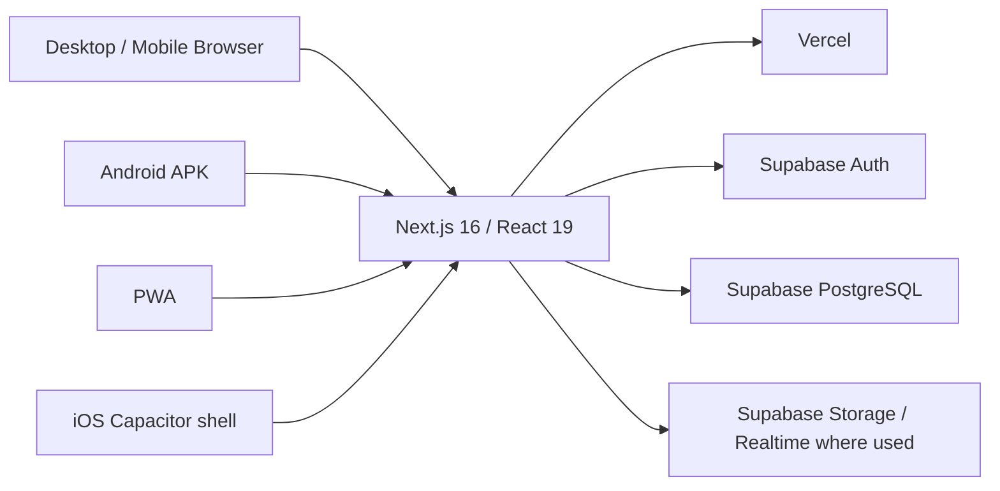

# Maya Steel Works Management System


[](https://github.com/lumuxav/maya-steel-works/actions/workflows/build-android-apk.yml)

A production business-management platform built specifically for **Maya Steel Works — Maya Branch**.

Maya combines inventory, deliveries, production, sales, customer-owned material work, credit/debt, debt repayments, cash, expenses, banking, alerts, reports, user management and system administration in one responsive system.

> **Production:** https://maya-steel-works-mgt.vercel.app

## Download the Android app

For normal installation, **do not download old APKs from GitHub Actions**. Use the maintained Latest Release:

- **Latest Android release:** https://github.com/lumuxav/maya-steel-works/releases/latest
- **Direct APK:** https://github.com/lumuxav/maya-steel-works/releases/download/maya-latest/Maya-Steel-Works.apk
- **Download guide:** [DOWNLOADS.md](DOWNLOADS.md)

The current Android build includes:

- Capacitor 8 native shell
- Maya launcher icon and splash assets
- Android safe-area and system-bar handling
- responsive phone/tablet layouts
- native keyboard handling
- persistent Supabase login sessions
- native Android Back-button navigation: sub-pages navigate back inside Maya; Home is the screen from which Back may exit the app

The APK currently remains an **internal/direct-install debug-signed build**. Before broad staff distribution and seamless long-term APK upgrades, configure a stable release signing key/keystore.

---

## Project documentation

Read these before making major production changes:

- **[Complete handover PDF](docs/Maya-Steel-Works-System-Handover.pdf)**
- **[Main handover source](docs/MAYA_SYSTEM_HANDOVER.md)**
- **[Latest production-status addendum](docs/LATEST_PRODUCTION_STATUS.md)**
- **[Production cutover notes](docs/PRODUCTION_CUTOVER.md)**

The handover PDF is generated automatically from the main handover plus the latest-status addendum.

A future developer or ChatGPT session should read these documents and then inspect the current `main` branch before modifying the system.

---

## Production architecture



**Production source of truth:** `main`  
**Correct Vercel project:** `maya-steel-works-eboa`  
**Android package ID:** `com.mayasteelworks.management`

The old duplicate Vercel project connection named `maya-steel-works` was disconnected. Only `maya-steel-works-eboa` should deploy this repository.

---

## Business scope

This installation is intentionally **Maya Branch only**.

The system must not combine or imply knowledge of stock, sales, banking, cash, production or other activity from branches that are not recorded here.

### Inventory

- raw-material inventory
- finished-goods inventory
- delivery receiving
- quantity tracking
- stocktake
- corrections/audit history
- lifecycle reports

### Production

- consume Maya-owned raw material
- create finished goods
- expected vs actual yield
- scrap/waste where applicable
- production history and variance alerts

### Sales & credit

- finished-goods sales
- raw-material sales
- Paid / Partial / Credit sales
- automatic stock deduction where applicable
- customer balances
- later debt repayments

### Customer-owned material

Customers can bring their own material for ribbing/forming, cutting strips, louvers or other processing.

**Customer-owned material must never deduct Maya inventory.**

The system records pieces/plates worked, charge per piece, customer, payment status and service revenue only.

### Cash Book & Banking

- opening cash carried forward
- cash received today
- source breakdown: sales, service work, debt repayments, etc.
- expenses
- cash still on hand
- pending/confirmed banking
- continuous historical cash archive

Unbanked closing cash carries into the next business day.

### Alerts & Reports

Management activity includes credit sales, debt repayments, banking exceptions, production variances, stocktake differences, expenses and other business flags.

---

## Roles

### Employee

Handles normal operational workflows permitted to staff.

### Admin

The **Admin is the business owner/manager**, with business-level oversight of sales, credit, cash, banking, production, alerts and reports.

### Super Admin

The **Super Admin is the technical/system administrator**, responsible for accounts, roles, password resets, disabling/reactivating users, safe account removal/archiving, system monitoring and troubleshooting.

Admin and Super Admin responsibilities must remain separate.

---

## Authentication & sessions

Supabase Auth is used for login.

Current session behavior:

- sessions persist across normal app closes/reopens and device restarts
- tokens auto-refresh
- returning users skip the login form when a valid active session exists
- temporary network/profile-check failures do not destroy a valid saved session
- a confirmed inactive/deleted account is forced out
- active sessions regularly re-check account access so deactivation does not depend on the user voluntarily logging out

Never expose `SUPABASE_SERVICE_ROLE_KEY` in browser/client code or prefix it with `NEXT_PUBLIC_`.

---

## Production hardening completed

### Test-data reset

On 26 Sep 2026, test operational data was cleared while preserving:

- Supabase Auth users
- Maya `public.users` profiles
- profile photos/storage

The destructive reset procedure is documented at `scripts/reset-test-business-data.sql` and must not be casually rerun.

### Supabase availability

Maya has a protected database-backed health endpoint:

```text
/api/health/supabase
```

GitHub Actions calls it every 6 hours using `.github/workflows/keep-supabase-active.yml`.

UptimeRobot separately monitors the production website every 5 minutes for availability.

### Supabase security

Privileged stock operations were hardened so anonymous/public callers cannot execute them. Privileged implementations were moved behind safer wrappers/private logic, and obsolete multi-branch stock-transfer access was disabled for normal signed-in users.

### Database performance

- missing foreign-key/history indexes were added
- high-traffic RLS expressions were optimized
- signed-in profile/session data is cached in memory
- Maya Branch lookup sets are briefly cached
- Home, Inventory and Sales independent queries are loaded in parallel

---

## Themes & responsive UX

Users can choose:

- Light
- Dark
- Navy

The mobile shell supports:

- safe-area insets for notches/punch-hole cameras
- dynamic viewport sizing
- phone/tablet responsive layouts
- portrait/landscape handling
- keyboard-aware navigation
- theme-aware Android system-bar areas
- iPhone-friendly form sizing to avoid unwanted input zoom

---

## Android

Workflow:

```text
.github/workflows/build-android-apk.yml
```

The workflow builds `Maya-Steel-Works.apk` and publishes/replaces the APK in the stable `maya-latest` GitHub Release.

For staff installation, use **Releases**, not old workflow artifacts.

Native changes such as Capacitor plugins, package configuration or Android system behavior require a new APK build. Normal web/business-logic changes are delivered through the live Vercel application and usually do not require reinstalling the APK.

---

## iPhone / iPad

The same Capacitor codebase is validated for iOS using:

```text
.github/workflows/validate-ios.yml
```

Unsigned iPhone/iPad simulator compilation currently passes, including the native Capacitor App plugin used for navigation support.

A signed `.ipa` is **not yet published**. Apple signing/provisioning and a distribution path such as TestFlight/App Store are still required.

---

## Desktop

Desktop/laptop users use the responsive production web system:

```text
https://maya-steel-works-mgt.vercel.app
```

There is currently no official `.exe` or `.dmg` package. Native desktop installers should only be claimed once actually packaged.

---

## Environment variables

Local development requires:

```env
NEXT_PUBLIC_SUPABASE_URL=your_supabase_project_url
NEXT_PUBLIC_SUPABASE_ANON_KEY=your_supabase_publishable_or_anon_key
SUPABASE_SERVICE_ROLE_KEY=your_server_side_secret
```

Production also uses:

```env
HEALTHCHECK_SECRET=strong_random_value
```

The matching GitHub Actions secret is:

```text
MAYA_HEALTHCHECK_SECRET
```

Never commit secrets to the repository.

---

## Local development

```bash
git clone https://github.com/lumuxav/maya-steel-works.git
cd maya-steel-works
npm install
npm run dev
```

Production build:

```bash
npm run build
npm start
```

Lint:

```bash
npm run lint
```

---

## Key data-integrity rules

1. Maya Branch only unless multi-branch support is explicitly reintroduced.
2. Maya-owned stock sales deduct inventory.
3. Customer-owned material processing never deducts Maya stock.
4. Debt repayment is not a new sale.
5. Debt repayments increase cash on the day received and remain identifiable as debt payments.
6. Expenses reduce cash-on-hand.
7. Confirmed banking reduces cash physically held.
8. Unbanked closing cash carries forward.
9. Historical user identity must remain available when required for audit records.
10. Disabled users must lose existing access, not only future login.
11. Admin = business owner/manager.
12. Super Admin = technical/system administrator.
13. Supabase service credentials remain server-side only.

---

## Recommended production checks

Before broad daily use, test:

- Employee/Admin/Super Admin login and permissions
- persistent login after app close/reopen
- forced logout after user deactivation
- receive stock
- production
- Paid/Partial/Credit sales
- debt repayment and cash-source reporting
- customer-owned material jobs
- expenses and banking
- cash carry-forward
- lifecycle history and stocktake
- Android Back-button navigation
- Light/Dark/Navy themes
- small/large phones and tablets

---

## Repository access & licence

This is **private/internal business software** for Maya Steel Works.

No open-source licence is currently provided. The source should not be treated as permission for public reuse, redistribution or commercial modification unless a licence is explicitly added later.

---

<p align="center">
  <strong>Maya Steel Works Management System</strong><br />
  Inventory · Production · Sales · Credit · Cash · Banking · Reporting · Administration
</p>
