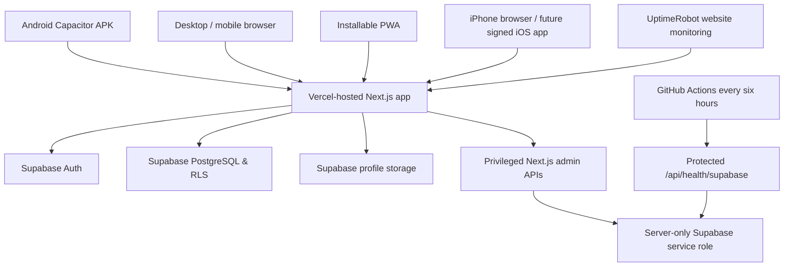

# Maya Steel Works — Architecture and Data Model

**Maintained:** 9 October 2026  
**Application:** Maya Steel Works Management System (**Maya Branch only**)  
**Source repository:** `lumuxav/maya-steel-works` (private)  
**Authoritative code:** GitHub `main` (recheck after future changes)  
**Business opening date:** Monday **12 October 2026**, time zone `Africa/Kampala`.

> This describes the implemented project as inspected on 9 October 2026. Some pages include historical legacy records. The presence of a table does **not** mean every record type is available as a current feature. Production data and customer records must never be copied into test environments.

## 1. System purpose and boundaries

Maya is a purpose-built, browser-accessible management system for Maya Steel Works, and not the Universal MGT platform. **Never** import, link, migrate, deploy, or merge Universal MGT code or data into this project. `lib/branch.js` defines `SYSTEM_BRANCH = 'Maya Branch'`; branches outside Maya are not part of operational reporting. Legacy cross-branch transfers are disabled at `/transfers`.

The business tracks steel/raw material received, processing and finished goods, customer-owned-material services, sales, customer debt, expenses, bankings, cash on hand, physical stock verification, corrections, staff access, and operational records.

## 2. Logical architecture

- **Frontend:** Next.js 16 App Router, React 19, CSS and responsive client components.
- **Hosting:** Vercel project `maya-steel-works-eboa`, URL `https://maya-steel-works-mgt.vercel.app`.
- **Authentication and persistence:** Supabase Auth and PostgreSQL; individual browser sessions are managed by `lib/supabase.js` / client-side session cache.
- **Server-only administration:** `/api/admin/users`, `/api/admin/system` verify active Super Admin before using the Supabase service-role client.
- **Atomic accounting:** `public.maya_ledger(text,jsonb,uuid)` handles sales, customer services, production, make-and-sell, repayments and adjustments. The `p_request_id` prevents replaying the same operation with different contents and returns the prior outcome for exact retries.
- **Audited corrections:** `public.maya_correct_record(text,bigint,jsonb,text,uuid)` records permitted changes and the audit log in one transaction; direct modification of protected financial tables is restricted.
- **Native Android:** Capacitor 8 loads the production Vercel URL, package `com.mayasteelworks.management`; `android-native/MainActivity.java` handles physical Back, alongside the browser route history logic.
- **PWA:** manifest and service worker for shell/offline fallback; authenticated transaction data is not an offline-first database.

## 3. Code map

| Path | Responsibility |
| --- | --- |
| `app/page.js` | Role-aware Home dashboard and quick actions |
| `app/components/AppShell.js` | Shared navigation, active-account checks and mobile footer |
| `app/components/NativeBackNavigation.js` | Maya route stack, back navigation and double-Back exit |
| `app/login/page.js` | Authentication |
| `app/inventory/page.js`, `app/inventory/history/page.js` | Stock inventory and movement history |
| `app/deliveries/page.js`, `app/stocktake/page.js` | Deliveries and physical count adjustments |
| `app/recipes/page.js`, `app/production/page.js`, `app/production-report/page.js` | Production standards, runs and yield reports |
| `app/sales/page.js`, `app/customer-work/page.js`, `app/sales-report/page.js` | Stock sales, customer-owned services, credit and repayment |
| `app/cashbook/page.js`, `app/profit/page.js` | Cash/expenses/banking and profitability |
| `app/records/page.js`, `app/alerts/page.js`, `app/corrections/page.js` | Discrepancy archive, alerts, audited corrections |
| `app/users/page.js`, `app/system-control/page.js`, `app/settings/page.js` | Technical access, monitoring, profile/preferences |
| `lib/mayaBusiness.mjs` | Kampala business dates, cash math and service-sale contract |
| `lib/branch.js` | Maya-only branch lookup / short-lived cache |
| `lib/mayaPasswordPolicy.mjs` | Staff password creation/reset validation |
| `supabase/migrations/` | Versioned deployed database changes; no reset during maintenance |
| `.github/workflows/` | CI tests, Android APK, iOS validation and keep-alive |

## 4. Database table catalogue (observed in Maya Supabase)

| Schema.table | Main use / significant columns |
| --- | --- |
| `auth.users` | Supabase login identities and credentials (managed by Auth; never manually copy secrets) |
| `public.users` | Staff `id`, `full_name`, `role`, `active`, `branch`, audit identity |
| `public.deliveries` | Supplier, delivery date, receiver and transport cost |
| `public.raw_materials` | Category, gauge, size, quantities, unit, cost fields, `delivery_id`, `current_branch` |
| `public.finished_goods` | Item name, gauge, size, quantity, unit, selling price |
| `public.production_recipes` | Raw category/gauge/size, finished design/size, expected yield per raw unit |
| `public.production_log` | Raw used, finished yield, scrap, standard expected yield, employee |
| `public.sales` | Sold item type/id, quantity, total, `amount_paid`, `adjustments`, customer, staff/time |
| `public.debt_events` | Payment/return/compensation events, amount, optional associated sale/customer |
| `public.stock_movements` | Stock ledger with signed quantity changes, movement type and author |
| `public.stocktakes` | System quantity, physical count, variance, counter and date |
| `public.expenses` | Description, category, amount, recorder and timestamp |
| `public.expense_categories` | Configurable expense category names |
| `public.bankings` | Date, amount, method, pending/confirmed status, variance, author and confirmer |
| `public.corrections_log` | Field-by-field old/new values, reason, changed_by and time |
| `public.customer_materials` | Legacy/separate customer-material intake metadata; current billable services are `sales.item_type='service'` |
| `public.branch_transfers` | Historical/legacy transfer table; Maya cross-branch transfers disabled |

Other server-side implementation tables reside in the private schema, including `private.maya_operation_keys` for idempotent requests. User-facing financial history should be read through permitted views and policies, not unrestricted SQL.

### Selected relationships

- `public.users.id` corresponds to `auth.users.id`.
- `raw_materials.delivery_id` references `deliveries.id`.
- `production_log.raw_material_id` / `finished_good_id` associate input and output stock.
- `sales.sold_by`, `expenses.recorded_by`, `bankings.recorded_by`, `stock_movements.recorded_by` reference staff.
- `debt_events.sale_id` optionally references `sales.id`.
- Stock/service sales use `sales.item_type`: `raw`, `finished`, or `service`. A customer-owned service uses `item_id=0` as a **non-stock sentinel**; never interpret it as a Maya-owned stock ID.

## 5. Essential accounting invariants

1. Normal stock sales deduct the correct Maya-owned stock **once** and record one sale.
2. Customer-provided material earns a service fee without deducting Maya stock.
3. Production consumes raw material and increases finished-goods inventory atomically, with production and stock-movement history.
4. Make-and-sell produces and sells as one atomic business operation.
5. A credit sale records an outstanding invoice; later repayments are separate `debt_events`, **not additional sales**.
6. Partial and full payments have positive amounts and cannot exceed the applicable limits except explicit recorded advances.
7. Cash received on day D = money received from sales/services on D + repayments received on D (not a double count of later repayment).
8. Expected closing cash = opening cash + receipts − expenses − **confirmed** bankings. Pending banking is not treated as confirmed cash outflow.
9. The archive begins on `2026-10-12` in `Africa/Kampala`; date/time displays must not shift based on the viewer's device time zone.
10. Important financial changes need an authorized reason and an audit record saved atomically. Financial deletions and untracked direct edits are deliberately restricted.
11. An archived former employee cannot log in; restoring the **same individual** preserves audit ID and requires a new password/role review.
12. All transaction and correction handlers must check active Maya membership on the server/database side; UI visibility is not security enforcement.

## 6. Deployment and branch boundaries

The Vercel address is just the frontend location. **The database is not stored inside the Vercel domain or APK.** Changing to a purchased domain later should keep the same Maya Vercel and Supabase projects. Update Vercel DNS/domain, Supabase allowed redirect URLs and Capacitor server URL, rebuild native apps and test cookies/login.

Keep Vercel production bound to `main`. Use a PR with tests for production changes; isolate any database migration and back it up before release. **Never use the destructive test-data reset script on an operating business.**

## 7. Accuracy notes / known boundaries

- Users and roles were verified in the schema; this document does not supply real user names, emails, credentials or customer data.
- iOS compilation checks do not mean a signed iOS installable exists.
- Android releases are currently debug-signed; different debug keys may require uninstall/reinstall. Stable signing is an outstanding distribution improvement.
- Some reports cap displayed history to a limited number of records and are **not a substitute for a verified full-ledger export** at high transaction volumes.
- This architecture snapshot should be updated after every major schema, role, mobile or deployment change.
